# NEBULA Client — Minecraft 1.21.11 (Fabric)

Client visuel « premium dark / liquid glass » pour Minecraft **1.21.11** sous **Fabric**, avec un moteur de rendu GPU dédié à l'interface (SDF, flou gaussien, verre), de vraies orbes 3D émissives avec bloom autour du joueur, des traînées de mouvement, un HUD déplaçable et un ClickGUI complet.

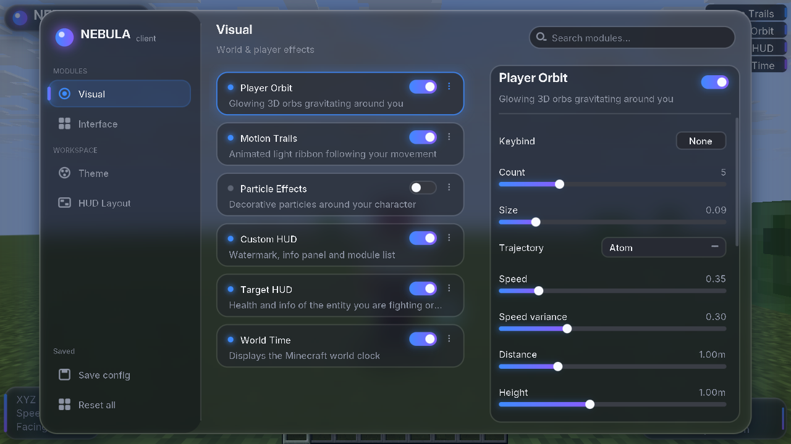

| Orbes 3D + traînée (Helix, 11 orbes) | Nuit : orbes, particules et traînée |
|---|---|
| 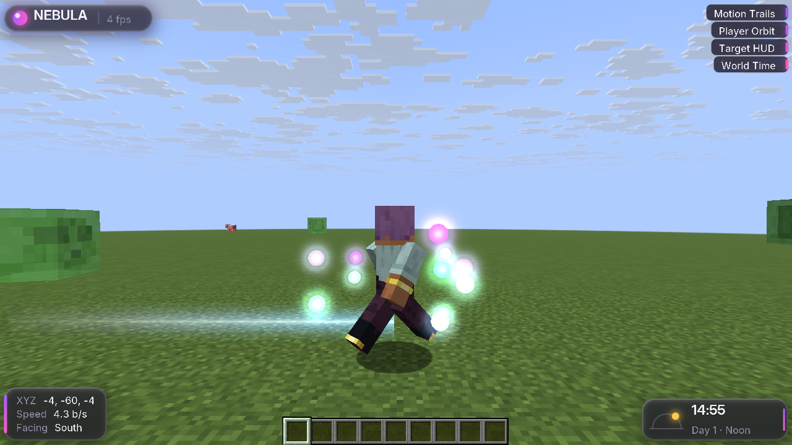 | 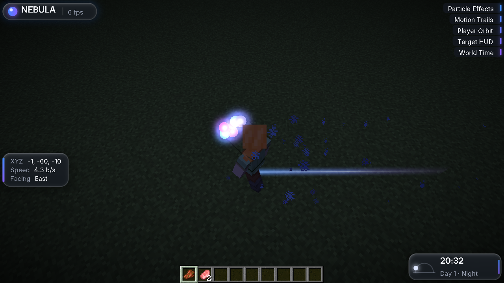 |
| **Color picker HSV** | **Éditeur de HUD (glisser-déposer)** |
| 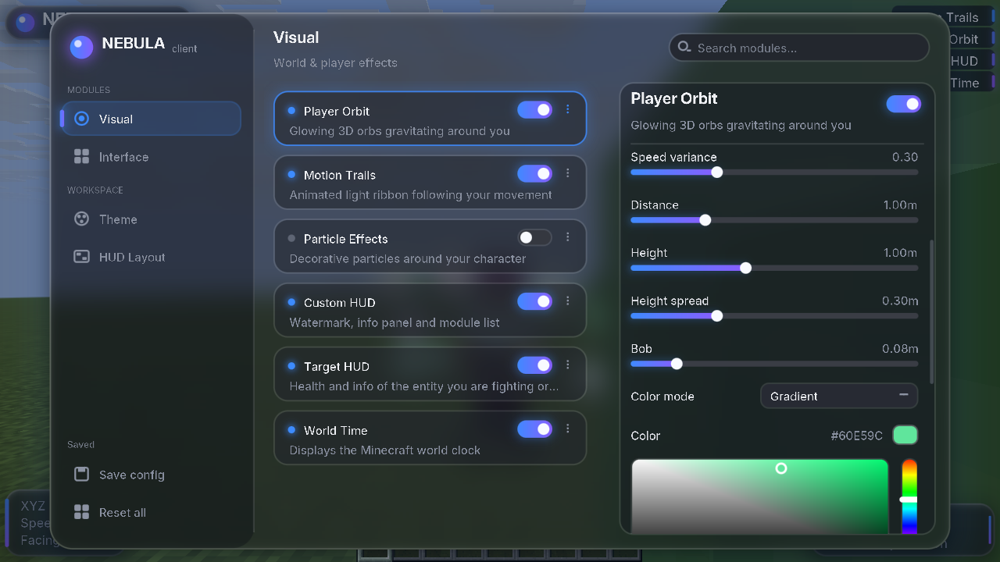 | 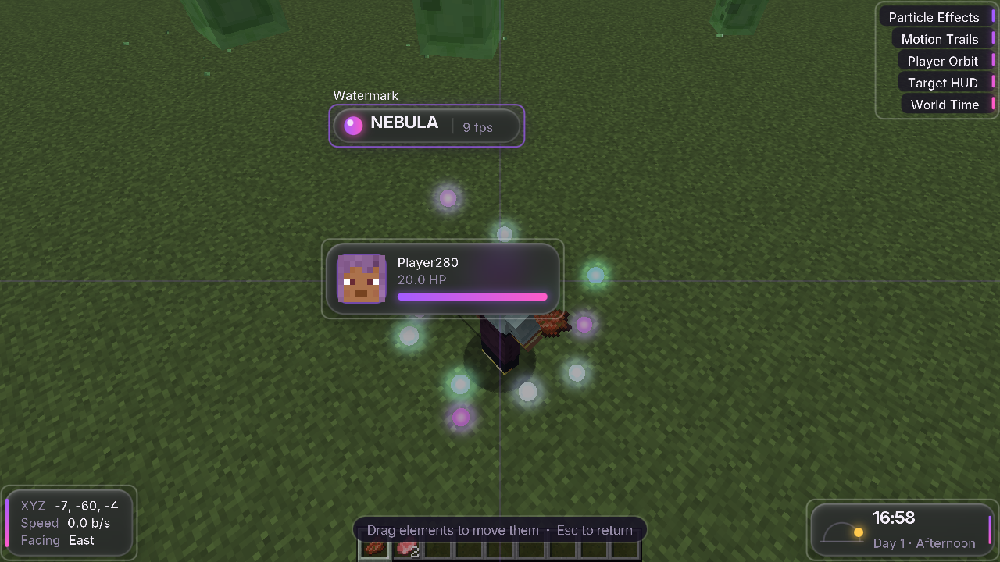 |
| **Halo + Jump Circles + orbes** | **Target ESP (anneaux + comètes) et crosshair** |
| 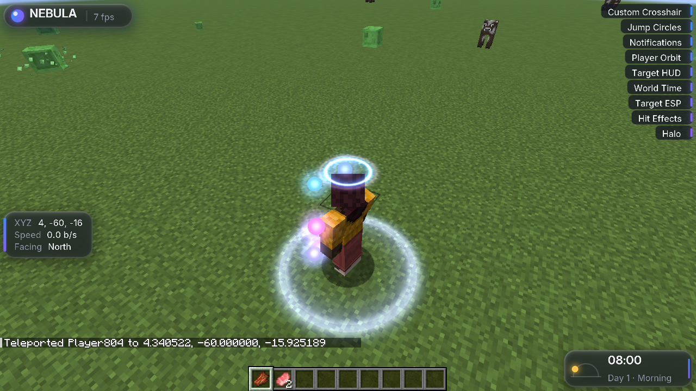 | 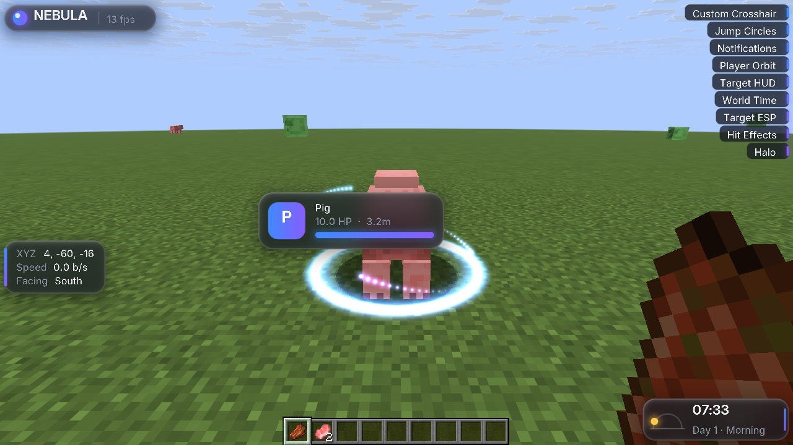 |
| **Hit Effects (gerbe + onde de choc)** | **Halo vu de face** |
| 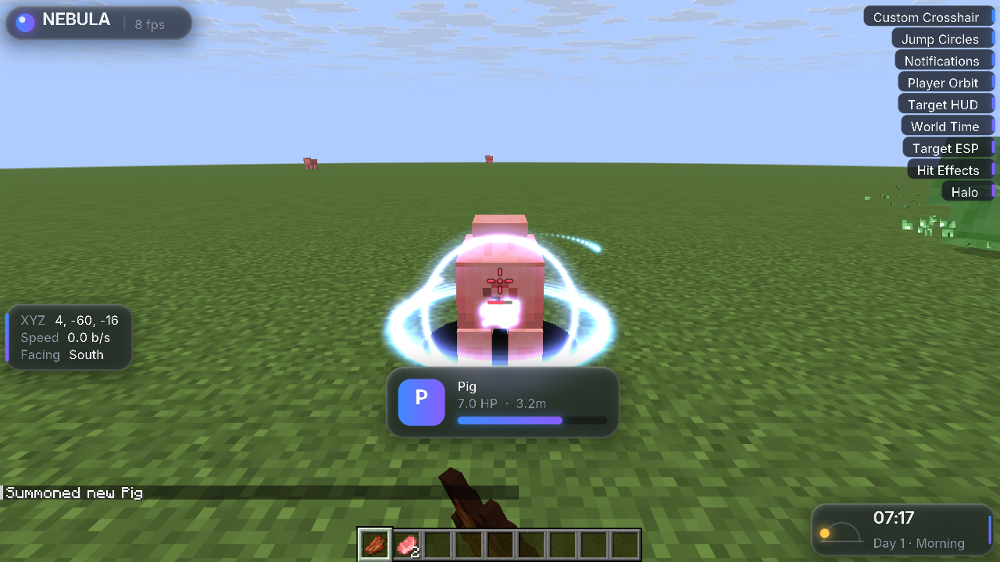 | 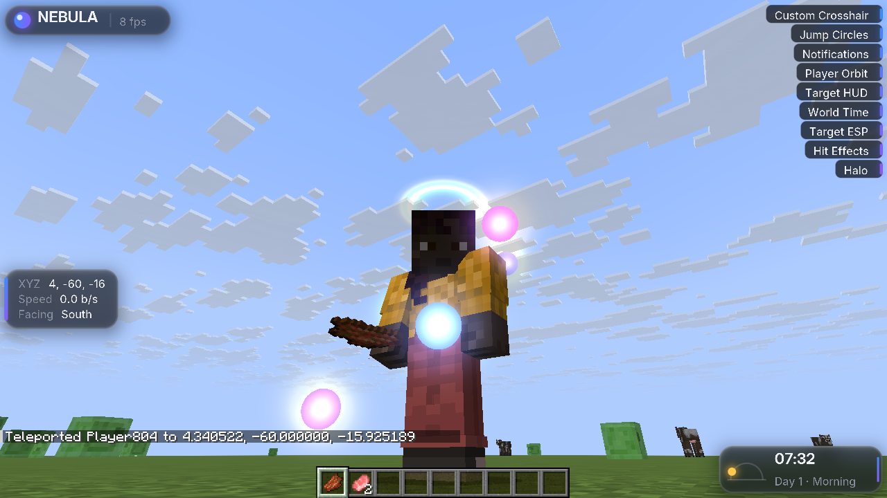 |
| **Custom Sky + Aurora (nuit, étoile filante)** | **Custom Sky de jour** |
| 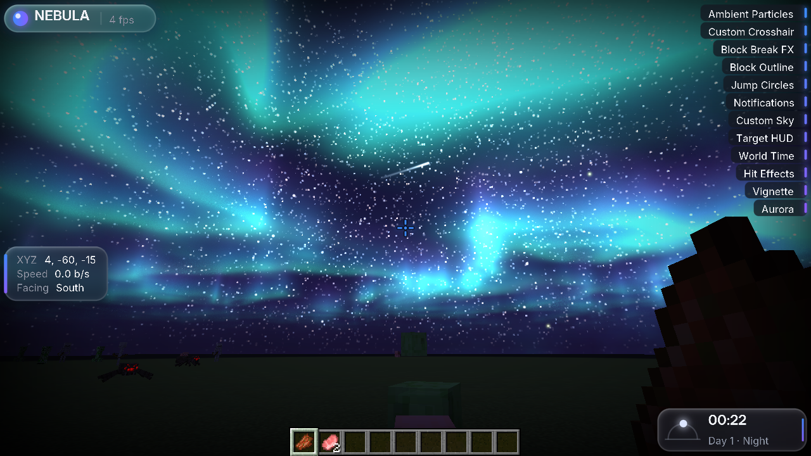 | 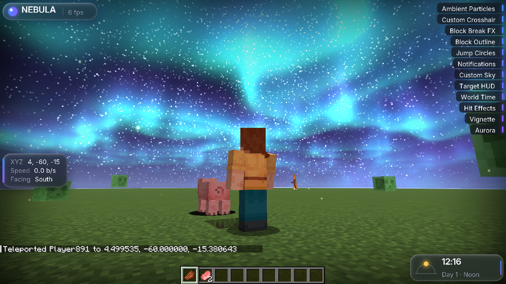 |
| **Block Outline lumineux** | **Block Break FX (boîte fantôme + étincelles)** |
| 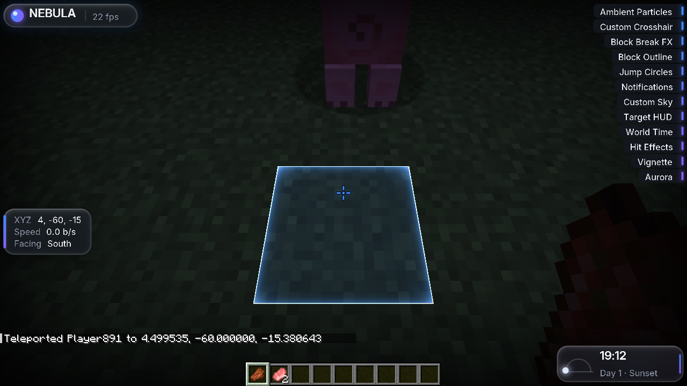 | 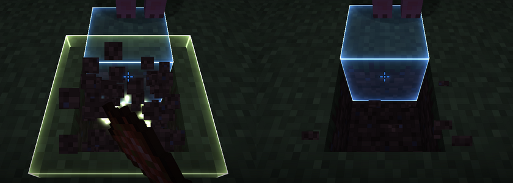 |

Toutes les captures proviennent du vrai client lancé dans cet environnement (Xvfb + Mesa llvmpipe, rendu logiciel, d'où les FPS bas affichés).

---

## Installation

1. Installer **Fabric Loader ≥ 0.20.1** pour Minecraft **1.21.11**.
2. Mettre **Fabric API** (0.141.x+1.21.11) dans `.minecraft/mods`.
3. Copier `nebula-1.0.0.jar` dans `.minecraft/mods`.
4. Lancer le jeu, entrer dans un monde, appuyer sur **Shift droit** pour ouvrir le ClickGUI.

Le mod est purement client (`"environment": "client"`), il ne touche à rien côté serveur.

### Compiler depuis les sources

```bash
# Gradle doit tourner sous Java 25 (exigence de Loom 1.19) ; le mod est compilé pour Java 21.
export JAVA_HOME=/chemin/vers/jdk-25
./gradlew build          # -> build/libs/nebula-1.0.0.jar
./gradlew runClient      # client de développement
```

Le projet a été généré avec le générateur officiel Fabric (archive `nebula-template-1.21.11.zip` fournie, premier commit = template intact) puis vérifié : Minecraft 1.21.11, Loader 0.20.1, Fabric API 0.141.6+1.21.11, Loom 1.19-SNAPSHOT, Gradle 9.8.2, mappings officiels Mojang. Seule modification de configuration : `org.gradle.jvmargs=-Xmx3G` (la décompilation des sources manquait de mémoire avec 1G). Log de compilation : [`docs/build-log.txt`](docs/build-log.txt).

## Utilisation

| Action | Contrôle |
|---|---|
| Ouvrir / fermer le ClickGUI | Shift droit (modifiable dans *Interface → ClickGUI*) ; Échap ferme |
| Activer / désactiver un module | clic gauche sur sa carte |
| Ouvrir les paramètres d'un module | clic droit sur la carte (ou les « ⋮ ») |
| Rechercher | cliquer la barre de recherche (filtre toutes les catégories) |
| Raccourci d'un module | *Keybind* → cliquer → appuyer sur une touche (Retour arrière = aucun, Échap = annuler) |
| Slider | glisser, ou flèches ←/→ au survol |
| Déplacer le HUD | *HUD Layout* dans la barre latérale, puis glisser les éléments |
| Sauvegarder / réinitialiser | *Save config* / *Reset all* (double clic de confirmation) |

## Modules

**Visual**
- **Player Orbit** — orbes 3D : nombre (1–16), taille, trajectoire (Circle, Ellipse, Atom, Helix, Lissajous), vitesse et variance par orbe, distance, hauteur, écart vertical, flottement, couleur (unique / dégradé / arc-en-ciel), intensité d'émission, halo (intensité + taille), bloom (on/off, force, rayon), affichage en 1re personne.
- **Motion Trails** — ruban lumineux qui suit le joueur : durée, style (Ribbon / Ground / Halo), largeur, couleurs tête/queue, arc-en-ciel ou couleurs du thème, opacité.
- **Particle Effects** — particules décoratives locales : type (Stardust coloré, Aura colorée, Sparkle, Glow, Electric, Soul), motif (Aura, Feet, Spiral, Moving only), densité, rayon, couleur, arc-en-ciel, taille.
- **Custom HUD** — watermark (logo + FPS), panneau d'infos (XYZ, vitesse, orientation), liste animée des modules actifs, halo d'accent, échelle, éditeur de disposition.
- **Target HUD** — entité visée (ou dernière attaquée) : visage du joueur / monogramme, PV + absorption, armure, distance, barre de vie animée (dégradé / couleur selon PV / thème).
- **World Time** — heure du monde Minecraft (24 h ou 12 h), jour, phase, arc soleil/lune.
- **Jump Circles** — anneaux lumineux qui s'étendent au sol au saut et/ou à l'atterrissage : rayon, durée, épaisseur, remplissage, échos, couleur (thème / perso / arc-en-ciel).
- **Halo** — auréole lumineuse flottant au-dessus de la tête avec étincelles en orbite : rayon, hauteur, épaisseur, éclat, nombre d'étincelles, couleur.
- **Target ESP** — autour de la cible (regardée ou dernière frappée) : colonne d'anneaux qui scanne de haut en bas et comètes en orbite avec traînée ; style, vitesse, nombre/taille des comètes, couleur.
- **Hit Effects** — à chaque coup : gerbe d'étincelles balistiques (avec traînée) émise du côté du joueur + onde de choc ; nombre, vitesse, durée, taille, gravité, couleur.
- **Custom Crosshair** — viseur SDF remplaçant le vanilla : Cross, Cross + Dot, Dot, Circle ; écart dynamique (déplacement, recharge), contour, halo, barre de recharge d'attaque, teinte rouge sur une entité.
- **Custom Sky** — ciel procédural en **deux modes**. **Nebula** : dégradé zénith/horizon, champ d'étoiles scintillantes en rotation lente, bande de nébuleuse avec poussières sombres, étoiles filantes ; préréglages (Nebula, Twilight, Deep Space, Aurora Night, Custom). **Celestial** : atmosphère pilotée par l'heure du monde, disque solaire + couronne, lune avec phase, étoiles qui s'effacent le jour, banc de nuages éclairé et animé, palettes (Golden Hour, Noon, Blood Moon, Alien Dusk, Custom), couverture/vitesse/détail des nuages. Communs : densité d'étoiles, opacité, « toujours / la nuit seulement », fondu dans le brouillard, masquage des nuages vanilla.
- **Aurora** — aurores boréales animées en rideaux : palettes (Borealis, Violet, Fire, Thème, Custom), intensité, vitesse, altitude, qualité, toujours / la nuit seulement ; atténuées sous la pluie.
- **Block Outline** — remplace le contour de bloc : boîte lumineuse aux arêtes nettes (épaisseur constante en pixels), coins brillants, remplissage pulsé ; glisse en douceur d'un bloc à l'autre et apparaît/disparaît en fondu ; couleur du thème, perso, arc-en-ciel ou couleur du bloc visé.
- **Block Break FX** — quand on casse un bloc : boîte fantôme qui s'agrandit et s'éteint + gerbe d'étincelles, dans la couleur du bloc cassé (ou couleur choisie).
- **Ambient Particles** — particules d'ambiance lumineuses autour du joueur : Fireflies (lucioles qui clignotent), Stardust, Snow, Embers, Spirits ; nombre, rayon, taille, luminosité, couleurs.
- **Item Beams** — faisceau vertical au-dessus des objets au sol, couleur de rareté (ou thème/perso), anneau au sol, étincelles montantes ; filtre « Uncommon and above » par défaut, portée réglable, rendu depth-testé.
- **Projectile Trails** — rubans-comètes derrière flèches, tridents, boules de neige, potions et boules de feu ; couleur par type, aura ou personnalisée. Les perles d'Ender restent gérées par Energy Trails.
- **Vignette** — assombrissement cinématique des bords de l'écran (noir, thème ou perso), pulsation rouge « battement de cœur » sous 30 % de vie.

**Interface**
- **ClickGUI** — touche d'ouverture.
- **Notifications** — toasts en verre (slide-in, barre de progression) à chaque activation/désactivation ; coin de l'écran, durée ; se placent au-dessus des panneaux du HUD du même coin.
- **Theme Editor** — 5 préréglages (Nebula, Violet Haze, Aurora, Crimson, Graphite) + 7 couleurs éditables (fond, panneau, accent, accent 2, bordure avec alpha, texte, texte secondaire).
- **GUI Settings** — échelle, vitesse des animations, opacité, rayon des coins, épaisseur des bordures, flou on/off + rayon, réfraction du verre, intensité des halos, verre sur le HUD.

---

## Rapport technique

### Architecture

```
com.nebula.client
├── NebulaClient                 point d'entrée Fabric
├── core/        ClientManager (câble les sous-systèmes aux événements Fabric), ModuleManager
├── modules/     Module, Category, ModuleEvents, visual/*, ui/*  (« interface » est un mot réservé Java)
├── settings/    Setting<T> + Bool/Number/Mode/Color/Keybind/Action
├── config/      ConfigManager (JSON)
├── rendering/   NebulaPipelines, ShapeElement, RoundedRenderer, GlowRenderer, BlurRenderer, Gradient, RenderUtils
│   ├── buffers/   ManagedTexture, BlurConfigBuffer
│   ├── effects/   GaussianBlur
│   └── world/     WorldEffects, OrbRenderer, SphereMesh, OrbFrame, TrailRenderer
├── gui/         ClickGui, HudEditorScreen, Style
│   ├── components/ UiComponent, ModuleButton, Toggle, Slider, Dropdown, ColorPicker, KeybindEditor,
│   │               SearchBar, CategoryTab, SettingComponent, ActionButton, Panel
│   ├── panels/     SidebarPanel, ModuleListPanel, SettingsPanel
│   ├── hud/        HudElement, HudManager
│   └── themes/     Theme, ThemePresets
├── mixin/       BufferBuilderAccessor, GuiRendererMixin, KeyboardHandlerMixin
└── utilities/   Animation, ColorUtil
shaders : assets/nebula/shaders/{core,post,include}
```

Pas de bus d'événements maison : les événements Fabric (tick, rendu monde, HUD, cycle de vie, attaque) suffisent et un bus supplémentaire aurait été une couche artificielle.

### Choix importants

**Interface rendue dans le pipeline GUI différé de 1.21.11.** Depuis 1.21.6, `GuiGraphics` n'appelle plus OpenGL : il enregistre des éléments dans un `GuiRenderState` qui les trie en couches puis les dessine. Nebula soumet ses formes comme de vrais `GuiElementRenderState` (`ShapeElement`) : elles sont donc empilées, découpées (scissor) et ordonnées avec le texte vanilla exactement comme des widgets natifs, sans aucun appel GL direct ni API obsolète.

**Paramètres SDF portés par les sommets.** Le renderer GUI regroupe tous les éléments d'un même pipeline en un seul draw call et n'expose pas d'uniform par élément. Un format de sommet dédié ajoute trois attributs (`RectData` = demi-taille/rayon/bordure, `BorderColor`, `ShapeParams` = flou/intensité/creux/opacité), écrits via un accesseur mixin sur `BufferBuilder`. Des centaines de formes différentes partagent ainsi un seul draw call. Les identifiants d'attributs sont pris dans les emplacements libres les plus hauts pour ne pas entrer en conflit avec d'autres mods.

**Moteur de formes (shaders `shape`, `glass`, `sdf.glsl`).**
- Rectangles arrondis par distance signée exacte ; anti-aliasing calculé avec `fwidth` → un pixel d'AA net quelle que soit l'échelle GUI.
- Bordures : couverture intérieure/extérieure, épaisseur libre, couleur par coin → bordures en dégradé.
- Ombres et halos : convolution gaussienne analytique du rectangle arrondi (approximation `erf`), sans texture ni passe de flou ; mode « creux » pour les halos.
- Dégradés : couleurs par coin (horizontal, vertical, maillage 4 coins) ; les dégradés multi-couleurs découpent le quad en segments qui partagent le même SDF, donc les coins restent exacts. Le carré HSV du color picker est un seul quad (blanc, teinte, noir, noir) : l'interpolation bilinéaire donne exactement le plan HSV.
- Opacité globale par élément, pour les fondus d'ouverture/fermeture du ClickGUI.

**Flou gaussien et verre.** Lorsqu'un élément « verre » est soumis, `BlurRenderer` note la demande ; juste avant que le renderer GUI ne dessine (mixin en tête de `GuiRenderer.render`), l'image 3D finale est réduite à ¼ de résolution (filtre boîte 4 taps bilinéaires), puis floutée par passes séparables horizontale/verticale avec la technique d'échantillonnage linéaire (2 texels par lecture). Les panneaux verre échantillonnent cette texture en espace écran, ajoutent une teinte, une réfraction sur les bords (normale du SDF) et un reflet spéculaire. Aucun travail si aucun panneau verre n'est visible. Les textures sont réallouées uniquement quand la taille change (changement de résolution géré) et libérées à l'arrêt.

**Orbes 3D.** Rendues à la fin de la passe principale du monde (`WorldRenderEvents.END_MAIN`), positions relatives à la caméra et interpolées avec le partial tick :
1. **Émission (surface)** : vraie géométrie — icosphère subdivisée (1 280 triangles) envoyée une seule fois dans des buffers GPU statiques ; une matrice par orbe. Le fragment shader combine plasma animé (bruit 3D), cœur chaud et contour de Fresnel ; écrit la profondeur, donc les orbes passent correctement derrière le joueur et les blocs.
2. **Halo** : quads face caméra avec décroissance gaussienne analytique, mélange additif, testés en profondeur.
3. **Bloom** (post-process écran) : les cœurs sont re-rendus dans un tampon émissif en utilisant la profondeur de la scène (une orbe cachée ne « bave » pas à travers un mur), flou gaussien demi-résolution, puis ajout sur l'image.
4. **Éclairage du monde : non implémenté.** Les orbes **n'éclairent pas** les blocs ni les entités. L'éclairage de Minecraft est basé sur des niveaux de lumière par bloc ; Nebula ne les modifie pas.

**Traînées.** Historique circulaire préalloué (positions horodatées, réinitialisé en cas de téléportation) ; ruban construit chaque image dans un `ByteBufferBuilder` réutilisé, un seul draw call additif.

**Effets « glow » du monde (Jump Circles, Halo, Target ESP, Hit Effects).** Un seul moteur générique (`GlowBatch`) : chaque module accumule des quads relatifs à la caméra — couchés au sol ou face caméra (orientation de la caméra) — puis les dessine en un draw call avec un shader qui donne la forme : `glow_ring` (anneau gaussien + halo + remplissage intérieur) ou `glow_spark` (point émissif). Mélange additif, test de profondeur sans écriture (occlusion correcte par les blocs et entités). Toutes les animations sont calculées à partir du temps réel (ex. trajectoires balistiques analytiques des étincelles), donc identiques quel que soit le nombre de FPS ; les états sont dans des tableaux préalloués. La cible commune (Target HUD / ESP / Hit Effects) est suivie par `TargetTracker`. Les étincelles (coups, blocs cassés) partagent un même `SparkPool`. Le contour de bloc utilise le shader `block_glow` : la distance aux arêtes est calculée en pixels écran (`fwidth`), donc l'épaisseur reste constante quelle que soit la distance.

**Ciel et aurores.** Un triangle plein écran posé exactement sur le plan lointain (profondeur 1,0) avec un test de profondeur `LEQUAL` : il ne touche que les pixels où rien n'a été dessiné, c'est-à-dire le ciel, sans masque ni copie de tampon. Le rayon de vue par pixel est reconstruit à partir de l'inverse de la projection et de la rotation caméra. Le ciel (`sky.fsh`) combine bruit fractal 3D (nébuleuse), étoiles hachées par cellules et étoiles filantes, et se fond dans la couleur de brouillard vanilla (`Fog` UBO) près de l'horizon pour éviter une couture avec le terrain lointain. Les aurores (`aurora.fsh`, algorithme original) traversent une pile de couches horizontales où un bruit « ridged » dessine des plis fins, plus lumineux en bas et s'estompant vers le haut, ce qui donne les rayons verticaux ; mélange additif. Les nuages vanilla sont masqués par un mixin sur la passe `addCloudsPass` (option).

**Animations indépendantes des FPS.** `Animation` intègre une approche exponentielle avec le temps réel écoulé (`1 - e^(-k·dt)`), chaque instance ayant sa propre horloge ; multiplicateur global réglable.

**Configuration.** `config/nebula/config.json` (Gson). Sauvegarde automatique 1,5 s après le dernier changement, à la fermeture du GUI et à l'arrêt ; écriture atomique (fichier temporaire + déplacement) ; valeurs validées (bornes, palette de modes, couleurs hex) ; clés absentes → valeurs par défaut ; fichier illisible → déplacé en `config.corrupt-<horodatage>.json`, valeurs par défaut restaurées.

**Performance.** Pas d'allocation de tampons GPU par image (textures/buffers persistants, réalloués seulement au redimensionnement) ; maillage de la sphère statique ; données d'orbes et historique de traînée préalloués ; un seul draw call pour toutes les formes d'un même pipeline ; flou à ¼ de résolution exécuté uniquement si nécessaire. Restent des petites allocations par image inhérentes à l'API GUI (un objet d'état par forme, comme les widgets vanilla).

### Fonctionnalités terminées et testées (dans le vrai client)

Testé en lançant Minecraft 1.21.11 + Fabric API dans cet environnement (Xvfb, Mesa llvmpipe OpenGL 4.5), avec de vraies entrées clavier/souris (xdotool), captures d'écran et lecture des logs :

- Compilation Gradle (sans avertissement) et chargement du mod ; initialisation des 9 modules.
- Compilation des shaders : le client vérifie et journalise `GPU pipelines compiled: 9/9`.
- Ouverture/fermeture du ClickGUI (Shift droit, Échap) avec animations.
- Clic gauche → bascule d'un module ; clic droit → panneau de paramètres ; défilement à la molette.
- Slider (glisser : Count 5 → 11), Dropdown (Atom → Helix), ColorPicker (carré SV + barre de teinte, nouvelle couleur sauvegardée), KeybindEditor (K puis J enregistrés), Toggle du module dans l'en-tête, recherche (« part » → Particle Effects).
- Raccourci de module en jeu (K désactive Player Orbit).
- Thèmes : préréglage Violet Haze appliqué en direct au GUI et au HUD.
- Orbes 3D visibles en 3e personne, positionnées autour du joueur, suivent ses déplacements, occlusion correcte, halo + bloom ; trajectoires Atom et Helix ; dégradé de couleur.
- Motion Trails (style Ribbon) en mouvement ; Particle Effects (Stardust) ; liste de modules animée.
- HUD : watermark, infos, liste de modules, heure du monde (jour et nuit) ; éditeur de HUD (glisser-déposer, position sauvegardée) ; Target HUD affiché (aperçu avec les données du joueur).
- Config : persistance après redémarrage, *Reset all* (retour aux valeurs par défaut sur disque), récupération d'un fichier JSON corrompu.
- Retour au menu puis *Quit Game* : arrêt propre, ressources GPU libérées sans erreur.
- Nouveaux visuels (compilation des shaders : 11/11) : Jump Circles au saut, Halo + étincelles, Target ESP sur un vrai cochon (anneaux + comètes, apparition animée), Hit Effects en le frappant (onde de choc, gerbe, PV 10 → 9 → 8), Custom Crosshair (teinte rouge sur la cible, barre de recharge), Notification lors d'un raccourci clavier, Target HUD sur une vraie cible.
- Ciel et ambiance (14/14 shaders) : Custom Sky de nuit et de jour (étoiles, nébuleuse, étoile filante, nuages masqués, raccord au brouillard), Aurora (Borealis), Ambient Particles (Fireflies), Vignette ; Block Outline (contour lumineux, glisse vers le bloc suivant), Block Break FX (boîte fantôme couleur herbe + étincelles en cassant un bloc).
- Logs sans erreur liée à Nebula (seules erreurs : absence de carte son et de compte Realms dans l'environnement).

### Implémenté mais non testé

- **Target HUD** : détection testée sur un cochon regardé ; le maintien après une attaque hors du viseur n'a pas été testé.
- Trajectoires Circle / Ellipse / Lissajous, styles de traînée Ground / Halo, types de particules autres que Stardust, mode arc-en-ciel.
- Options non exercées des nouveaux visuels : styles de crosshair autres que Cross + Dot, styles ESP « Ring » / « Comets » seuls, position des notifications en haut / à gauche, réglages personnalisés (seules les valeurs par défaut ont été vues en jeu).
- Ciel/ambiance : seuls le préréglage Nebula, la palette Borealis et le type Fireflies ont été vus ; la pulsation de vignette à faible vie, le mode « la nuit seulement » et le comportement dans le Nether/End (désactivé car sans lumière du ciel) n'ont pas été testés.
- Changement de taille de fenêtre en cours de jeu (code de réallocation présent, non exercé).
- **Vrai GPU** (NVIDIA/AMD/Intel) : uniquement testé en rendu logiciel Mesa ; le rendu devrait être identique mais les performances réelles n'ont pas été mesurées (sous llvmpipe : ~17 FPS sans orbes, ~9 avec orbes + bloom, ce qui reflète le CPU, pas un GPU).
- Serveurs multijoueur, compatibilité avec Sodium / Iris.

### Incomplet / limites connues

- Pas d'éclairage dynamique du monde par les orbes (volontairement non simulé, voir plus haut).
- Le verre floute l'image 3D, pas les autres couches GUI situées dessous (ex. éléments du HUD derrière la fenêtre du ClickGUI).
- Le flou derrière le HUD (« HUD glass ») coûte une passe de flou par image ; désactivable dans *GUI Settings*.
- Le ruban de traînée est vertical : vu de profil (déplacement perpendiculaire à la caméra) il apparaît comme une fine ligne.
- Les aurores sont le visuel le plus coûteux (une boucle de bruit par pixel de ciel) ; baisser « Quality » si les FPS chutent. En rendu logiciel le jeu tombe à ~4 FPS avec ciel + aurores (contre ~20 sans), ce qui n'est pas représentatif d'une carte graphique.
- Le ciel personnalisé en mode « Always » garde un ciel de nuit en plein jour (choix artistique) ; le terrain reste éclairé par le soleil vanilla.
- Orbes masquées en 1re personne par défaut (option *First person*).

### Bugs trouvés pendant les tests et corrigés

- Vérification des shaders lancée avant la fin du chargement des ressources → déplacée après le chargement.
- Écriture d'un uniform buffer pendant une passe de rendu ouverte (crash au premier bloom) → écriture avant l'ouverture de la passe.
- La touche qui ouvre le ClickGUI était retransmise à l'écran ouvert, qui se refermait aussitôt → l'événement est consommé.
- La touche capturée par le KeybindEditor s'ajoutait aussi dans la recherche → caractère suivant ignoré.
- Orbes surexposées en blanc → normalisation par le canal max (teinte conservée) et halo atténué au centre.

## Licence

CC0-1.0 (héritée du template). Police Inter : SIL Open Font License, voir `assets/nebula/font/inter_license.txt`.

## Immersion

Voir [docs/IMMERSION.md](docs/IMMERSION.md) : modules immersifs (caméra, mains, atmosphère, eau, son, HUD diegétique) et presets Cinematic / Subtle / Vanilla+.
## CounterCraft Knives — couteaux CS intégrés au client

Le mod embarque **directement dans le jar** les modèles 3D, textures et définitions d'items du pack CounterCraft Knife Pack (catégorie Immersion, module **CounterCraft Knives**) : **aucun resource pack séparé n'est nécessaire**. Les couteaux s'activent en nommant une épée ou une hache (enclume, ou commande ci-dessous) du nom exact d'un couteau.

**13 couteaux disponibles** (noms exacts) : `Bayonet`, `Bayonet Gradient`, `Bayonet Violet`, `M9 Bayonet`, `M9 Bayonet Gradient`, `M9 Bayonet Violet`, `Ursus`, `Ursus Gem`, `Ursus Violet`, `Stilletto`, `Dark Stilletto`, `Guonith`, `Guonith Au` — sur toutes les épées (bois → netherite, cuivre), toutes les haches et le mace.

Exemple en commande :
```mcfunction
/give @s minecraft:iron_sword[minecraft:custom_name="M9 Bayonet"]
```

**Animations façon Counter-Strike** (remplacent les animations génériques de Hand Animations quand un couteau est en main) :

| Action | Effet |
|---|---|
| Changer de slot vers le couteau | **Draw** : la lame sort du fourreau, pivot bas + rotation avec léger dépassement (≈0,45 s, réglable) |
| Touche **G** (modifiable) | **Inspect** CS : la lame se soulève, fait un tour complet sur un axe incliné en montrant le dos dentelé, micro-vibrations pendant la tenue, retour net (2,6 s réglables) |
| Clic gauche (attaque) | **Slash** : coup diagonal alterné gauche/droite (ou direction forcée), piqué du bout de lame et petite avance |
| Clic droit dans le vide | **Stab** : armé en retrait, puis coup de pointe en avant (0,5 s) avec son |
| Idle | **CS stance** : pose de garde légèrement relevée + micro-bruissements respiratoires ; **weapon sway** sur le mouvement de caméra |

Sons discrets (tirage, inspect, slash, stab) via des sons vanilla pitchés — désactivables. Intensité globale réglable (0–2×). Tous les réglages persistent dans la config (catégorie *Immersion → CounterCraft Knives*).

Notes :
- Les animations ne s'appliquent qu'à la main principale (le couteau renommé en main secondaire garde le rendu du pack, sans animations).
- Le stab se déclenche aussi sur les blocs non interactifs (comme en CS), mais pas sur les entités (pas de conflit avec les PNJ/panneaux).
- Vérifié en jeu sur le vrai client (modèles + toutes les animations testés en première personne) ; `G` est le bind par défaut car `F` est le bind vanilla « échanger avec la main secondaire ».

## Effets joueur (Aura Glow, Energy Trails, Step FX, Death FX)

Quatre modules de la catégorie Visual, rendus via `GlowBatch` avec trois nouveaux shaders (`glow_ribbon`, `glow_soft`, `glow_rune`).

- **Aura Glow** : couleur fixe / cycle RGB / dégradé tête → pieds / thème, pulsation en BPM, couleur réactive (vie basse → rouge, sprint → cyan, potion → couleur de l'effet, dégâts → flash). Contour vanilla optionnel teinté par l'aura. Orbitales (étincelles avec traînée, runes, orbes) dont le rayon et la vitesse suivent le mouvement. Cercle magique procédural (anneaux, runes, hexagramme) qui s'étend au sprint et au saut. Brume d'énergie (plus dense à l'arrêt), lueur au sol, yeux émissifs (option : seulement dans le noir), arme enchantée qui fait pulser l'aura, totem qui ajoute un halo doré.
- **Energy Trails** : rubans sur le dos, les mains, les pieds, la pointe de l'arme et le bout des ailes en élytres. Couleur selon l'aura, la vitesse ou l'action (dash, saut, élytres, sprint). Arc de swing à chaque coup, afterimages (dash / sprint / toujours), traînée violette derrière les perles d'Ender.
- **Step FX** : empreintes lumineuses, ondulations sur l'eau, étincelles sur la pierre au sprint, onde de choc à l'atterrissage (hauteur de chute minimale réglable).
- **Death FX** : dissolution en particules lumineuses à la mort, flash, anneau et colonne d'étincelles au respawn.

Limites :
- Le contour utilise le glow vanilla : visible à travers les murs, épaisseur fixe, pas de fade selon la distance.
- Les points d'ancrage et les afterimages viennent d'un squelette approximatif recalculé à partir des formules d'animation vanilla. Les afterimages sont des silhouettes d'énergie, pas des copies du modèle.
- Pas encore faits : shell additif, rim light fresnel (il faut s'accrocher au pipeline de rendu des entités de 1.21.11), vraie lumière dynamique, reflets.
- Vanilla n'a pas de double saut : l'onde de choc se déclenche seulement à l'atterrissage.
- Le code compile (`gradlew build` OK) mais n'a pas été testé en jeu dans cet environnement.

## Ciel céleste, Item Beams et Projectile Trails

### Custom Sky → mode `Celestial`

Le ciel reste **un seul module et une seule passe plein écran**. Un troisième module de ciel aurait superposé deux passes, deux palettes et deux jeux de réglages contradictoires sur les mêmes pixels. Le module expose donc `Sky = Nebula | Celestial`, et les réglages propres à chaque mode sont masqués via `visibleWhen`.

`Celestial` est piloté par l'heure réelle du monde (`getDayTime` + tick partiel) :

- dégradé atmosphérique jour/nuit calculé depuis l'élévation du soleil ;
- disque solaire et couronne, disque lunaire avec phase (jour 0 = pleine lune, comme vanilla) ;
- étoiles qui s'effacent le jour ;
- banc de nuages projeté sur un dôme, pas sur un plan infini : c'est ce qui évite les traînées radiales près de l'horizon, visibles sur la première prévisualisation ;
- nuages éclairés côté soleil (échantillon décalé) et animés par le vent ;
- pluie : luminosité réduite, palette grisée, couverture nuageuse augmentée ;
- palettes Golden Hour, Noon, Blood Moon, Alien Dusk, Custom.

Les paramètres voyagent dans `SkyPass` sans uniform supplémentaire : `TextureMat` colonnes 0–3 = zénith / horizon / soleil / ombre des nuages (leur `w` porte la direction du soleil et la phase lunaire), `ColorModulator` = opacité, densité d'étoiles, couverture, temps, `ModelOffset` = raccord brouillard, vitesse et détail des nuages.

Coût : une passe plein écran se paie au fragment, donc le détail des nuages (3 octaves par défaut) est le principal levier — descendre à 2 sur GPU intégré. Les nuages se coupent sans perdre le reste du ciel.

### Item Beams

Faisceaux verticaux au-dessus des objets au sol, couleur de rareté (ou thème/perso), anneau au sol et étincelles montantes. Le filtre « Uncommon and above » est actif par défaut pour éviter des centaines de faisceaux dans une ferme ; portée 24 m par défaut. Le rendu est depth-testé : c'est de la lumière dans le monde, pas un wallhack.

### Projectile Trails

Rubans-comètes derrière flèches, tridents, boules de neige, potions et boules de feu, avec couleur par type, par aura ou personnalisée. Les perles d'Ender sont volontairement exclues : Energy Trails s'en occupe déjà. Un seul parcours d'entités par image, et le batch (donc la géométrie et le draw call) n'est ouvert que si un projectile est visible ou qu'une trail est encore en train de s'effacer.

### Vérifications

- `gradlew build` OK (Loom 1.19.4), jar `nebula-1.0.0.jar` produit avec le shader et les deux modules.
- `sky_celestial.fsh` validé par compilation GLSL (WebGL2 / SwiftShader) et prévisualisé hors jeu en quatre ambiances (Golden Hour, Noon, nuit, Blood Moon) ; deux défauts corrigés à ce stade (traînées radiales, étoiles trop basses).
- Pas de partie testée ici : les pipelines sont compilés au premier rendu et un échec est signalé dans le log (`[Nebula] Shader pipeline ... failed to compile`).
