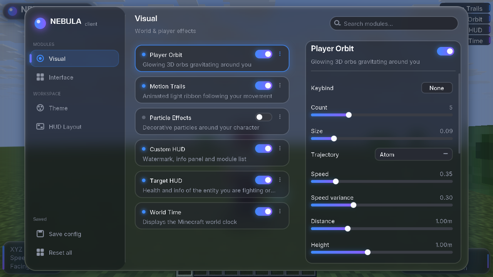
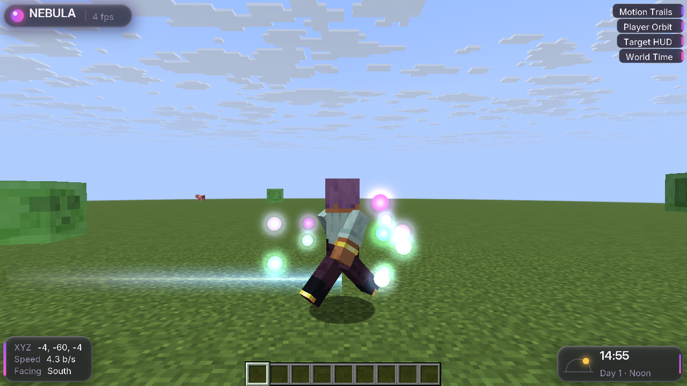
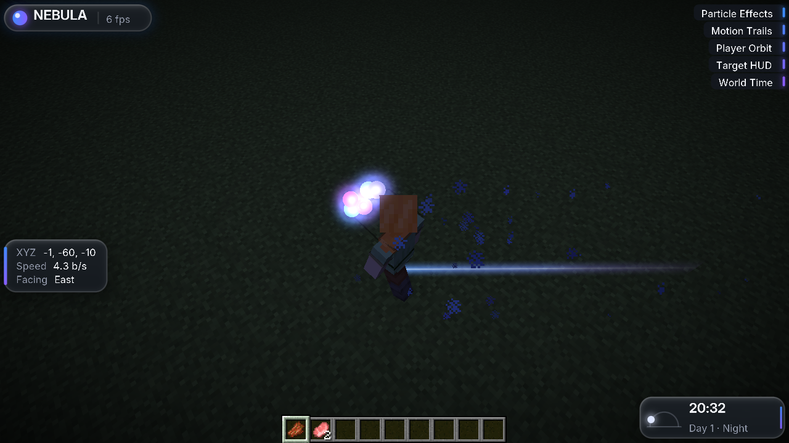
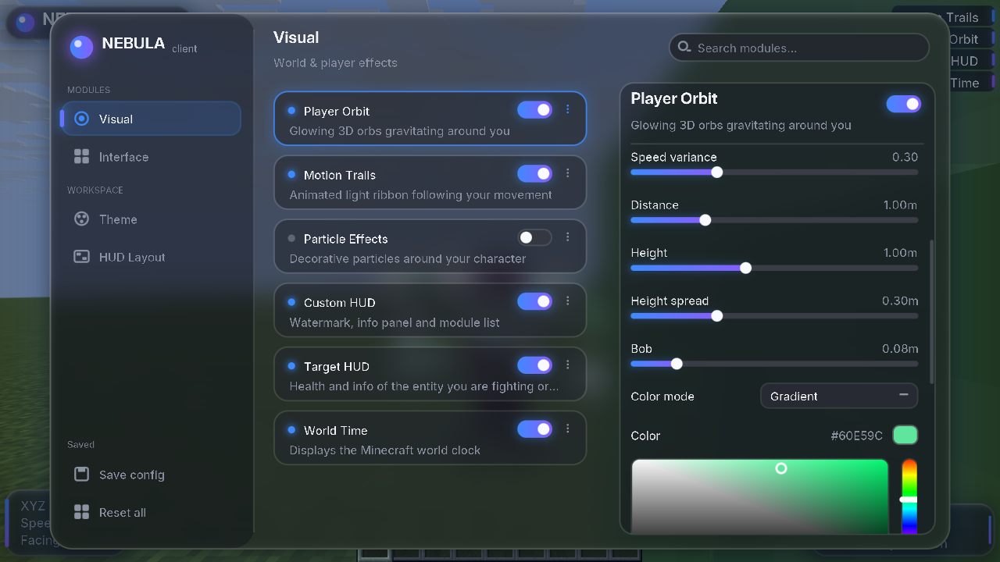
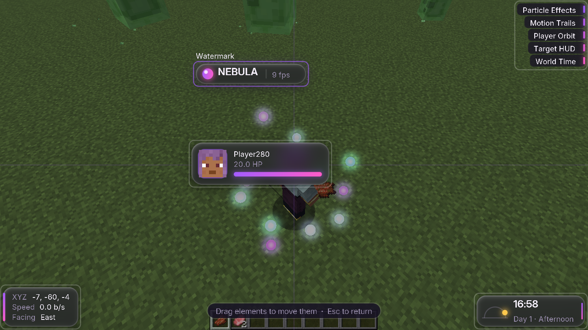

# NEBULA Client — Minecraft 1.21.11 (Fabric)

Client visuel « premium dark / liquid glass » pour Minecraft **1.21.11** sous **Fabric**, avec un moteur de rendu GPU dédié à l'interface (SDF, flou gaussien, verre), de vraies orbes 3D émissives avec bloom autour du joueur, des traînées de mouvement, un HUD déplaçable et un ClickGUI complet.



| Orbes 3D + traînée (Helix, 11 orbes) | Nuit : orbes, particules et traînée |
|---|---|
|  |  |
| **Color picker HSV** | **Éditeur de HUD (glisser-déposer)** |
|  |  |

Toutes les captures proviennent du vrai client lancé dans cet environnement (Xvfb + Mesa llvmpipe, rendu logiciel, d'où les FPS bas affichés).

---

## Installation

1. Installer **Fabric Loader ≥ 0.20.1** pour Minecraft **1.21.11**.
2. Mettre **Fabric API** (0.141.x+1.21.11) dans `.minecraft/mods`.
3. Copier `nebula-1.0.0.jar` dans `.minecraft/mods`.
4. Lancer le jeu, entrer dans un monde, appuyer sur **Shift droit** pour ouvrir le ClickGUI.

Le mod est purement client (`"environment": "client"`), il ne touche à rien côté serveur.

### Compiler depuis les sources

```bash
# Gradle doit tourner sous Java 25 (exigence de Loom 1.19) ; le mod est compilé pour Java 21.
export JAVA_HOME=/chemin/vers/jdk-25
./gradlew build          # -> build/libs/nebula-1.0.0.jar
./gradlew runClient      # client de développement
```

Le projet a été généré avec le générateur officiel Fabric (archive `nebula-template-1.21.11.zip` fournie, premier commit = template intact) puis vérifié : Minecraft 1.21.11, Loader 0.20.1, Fabric API 0.141.6+1.21.11, Loom 1.19-SNAPSHOT, Gradle 9.8.2, mappings officiels Mojang. Seule modification de configuration : `org.gradle.jvmargs=-Xmx3G` (la décompilation des sources manquait de mémoire avec 1G). Log de compilation : [`docs/build-log.txt`](docs/build-log.txt).

## Utilisation

| Action | Contrôle |
|---|---|
| Ouvrir / fermer le ClickGUI | Shift droit (modifiable dans *Interface → ClickGUI*) ; Échap ferme |
| Activer / désactiver un module | clic gauche sur sa carte |
| Ouvrir les paramètres d'un module | clic droit sur la carte (ou les « ⋮ ») |
| Rechercher | cliquer la barre de recherche (filtre toutes les catégories) |
| Raccourci d'un module | *Keybind* → cliquer → appuyer sur une touche (Retour arrière = aucun, Échap = annuler) |
| Slider | glisser, ou flèches ←/→ au survol |
| Déplacer le HUD | *HUD Layout* dans la barre latérale, puis glisser les éléments |
| Sauvegarder / réinitialiser | *Save config* / *Reset all* (double clic de confirmation) |

## Modules

**Visual**
- **Player Orbit** — orbes 3D : nombre (1–16), taille, trajectoire (Circle, Ellipse, Atom, Helix, Lissajous), vitesse et variance par orbe, distance, hauteur, écart vertical, flottement, couleur (unique / dégradé / arc-en-ciel), intensité d'émission, halo (intensité + taille), bloom (on/off, force, rayon), affichage en 1re personne.
- **Motion Trails** — ruban lumineux qui suit le joueur : durée, style (Ribbon / Ground / Halo), largeur, couleurs tête/queue, arc-en-ciel ou couleurs du thème, opacité.
- **Particle Effects** — particules décoratives locales : type (Stardust coloré, Aura colorée, Sparkle, Glow, Electric, Soul), motif (Aura, Feet, Spiral, Moving only), densité, rayon, couleur, arc-en-ciel, taille.
- **Custom HUD** — watermark (logo + FPS), panneau d'infos (XYZ, vitesse, orientation), liste animée des modules actifs, halo d'accent, échelle, éditeur de disposition.
- **Target HUD** — entité visée (ou dernière attaquée) : visage du joueur / monogramme, PV + absorption, armure, distance, barre de vie animée (dégradé / couleur selon PV / thème).
- **World Time** — heure du monde Minecraft (24 h ou 12 h), jour, phase, arc soleil/lune.

**Interface**
- **ClickGUI** — touche d'ouverture.
- **Theme Editor** — 5 préréglages (Nebula, Violet Haze, Aurora, Crimson, Graphite) + 7 couleurs éditables (fond, panneau, accent, accent 2, bordure avec alpha, texte, texte secondaire).
- **GUI Settings** — échelle, vitesse des animations, opacité, rayon des coins, épaisseur des bordures, flou on/off + rayon, réfraction du verre, intensité des halos, verre sur le HUD.

---

## Rapport technique

### Architecture

```
com.nebula.client
├── NebulaClient                 point d'entrée Fabric
├── core/        ClientManager (câble les sous-systèmes aux événements Fabric), ModuleManager
├── modules/     Module, Category, ModuleEvents, visual/*, ui/*  (« interface » est un mot réservé Java)
├── settings/    Setting<T> + Bool/Number/Mode/Color/Keybind/Action
├── config/      ConfigManager (JSON)
├── rendering/   NebulaPipelines, ShapeElement, RoundedRenderer, GlowRenderer, BlurRenderer, Gradient, RenderUtils
│   ├── buffers/   ManagedTexture, BlurConfigBuffer
│   ├── effects/   GaussianBlur
│   └── world/     WorldEffects, OrbRenderer, SphereMesh, OrbFrame, TrailRenderer
├── gui/         ClickGui, HudEditorScreen, Style
│   ├── components/ UiComponent, ModuleButton, Toggle, Slider, Dropdown, ColorPicker, KeybindEditor,
│   │               SearchBar, CategoryTab, SettingComponent, ActionButton, Panel
│   ├── panels/     SidebarPanel, ModuleListPanel, SettingsPanel
│   ├── hud/        HudElement, HudManager
│   └── themes/     Theme, ThemePresets
├── mixin/       BufferBuilderAccessor, GuiRendererMixin, KeyboardHandlerMixin
└── utilities/   Animation, ColorUtil
shaders : assets/nebula/shaders/{core,post,include}
```

Pas de bus d'événements maison : les événements Fabric (tick, rendu monde, HUD, cycle de vie, attaque) suffisent et un bus supplémentaire aurait été une couche artificielle.

### Choix importants

**Interface rendue dans le pipeline GUI différé de 1.21.11.** Depuis 1.21.6, `GuiGraphics` n'appelle plus OpenGL : il enregistre des éléments dans un `GuiRenderState` qui les trie en couches puis les dessine. Nebula soumet ses formes comme de vrais `GuiElementRenderState` (`ShapeElement`) : elles sont donc empilées, découpées (scissor) et ordonnées avec le texte vanilla exactement comme des widgets natifs, sans aucun appel GL direct ni API obsolète.

**Paramètres SDF portés par les sommets.** Le renderer GUI regroupe tous les éléments d'un même pipeline en un seul draw call et n'expose pas d'uniform par élément. Un format de sommet dédié ajoute trois attributs (`RectData` = demi-taille/rayon/bordure, `BorderColor`, `ShapeParams` = flou/intensité/creux/opacité), écrits via un accesseur mixin sur `BufferBuilder`. Des centaines de formes différentes partagent ainsi un seul draw call. Les identifiants d'attributs sont pris dans les emplacements libres les plus hauts pour ne pas entrer en conflit avec d'autres mods.

**Moteur de formes (shaders `shape`, `glass`, `sdf.glsl`).**
- Rectangles arrondis par distance signée exacte ; anti-aliasing calculé avec `fwidth` → un pixel d'AA net quelle que soit l'échelle GUI.
- Bordures : couverture intérieure/extérieure, épaisseur libre, couleur par coin → bordures en dégradé.
- Ombres et halos : convolution gaussienne analytique du rectangle arrondi (approximation `erf`), sans texture ni passe de flou ; mode « creux » pour les halos.
- Dégradés : couleurs par coin (horizontal, vertical, maillage 4 coins) ; les dégradés multi-couleurs découpent le quad en segments qui partagent le même SDF, donc les coins restent exacts. Le carré HSV du color picker est un seul quad (blanc, teinte, noir, noir) : l'interpolation bilinéaire donne exactement le plan HSV.
- Opacité globale par élément, pour les fondus d'ouverture/fermeture du ClickGUI.

**Flou gaussien et verre.** Lorsqu'un élément « verre » est soumis, `BlurRenderer` note la demande ; juste avant que le renderer GUI ne dessine (mixin en tête de `GuiRenderer.render`), l'image 3D finale est réduite à ¼ de résolution (filtre boîte 4 taps bilinéaires), puis floutée par passes séparables horizontale/verticale avec la technique d'échantillonnage linéaire (2 texels par lecture). Les panneaux verre échantillonnent cette texture en espace écran, ajoutent une teinte, une réfraction sur les bords (normale du SDF) et un reflet spéculaire. Aucun travail si aucun panneau verre n'est visible. Les textures sont réallouées uniquement quand la taille change (changement de résolution géré) et libérées à l'arrêt.

**Orbes 3D.** Rendues à la fin de la passe principale du monde (`WorldRenderEvents.END_MAIN`), positions relatives à la caméra et interpolées avec le partial tick :
1. **Émission (surface)** : vraie géométrie — icosphère subdivisée (1 280 triangles) envoyée une seule fois dans des buffers GPU statiques ; une matrice par orbe. Le fragment shader combine plasma animé (bruit 3D), cœur chaud et contour de Fresnel ; écrit la profondeur, donc les orbes passent correctement derrière le joueur et les blocs.
2. **Halo** : quads face caméra avec décroissance gaussienne analytique, mélange additif, testés en profondeur.
3. **Bloom** (post-process écran) : les cœurs sont re-rendus dans un tampon émissif en utilisant la profondeur de la scène (une orbe cachée ne « bave » pas à travers un mur), flou gaussien demi-résolution, puis ajout sur l'image.
4. **Éclairage du monde : non implémenté.** Les orbes **n'éclairent pas** les blocs ni les entités. L'éclairage de Minecraft est basé sur des niveaux de lumière par bloc ; Nebula ne les modifie pas.

**Traînées.** Historique circulaire préalloué (positions horodatées, réinitialisé en cas de téléportation) ; ruban construit chaque image dans un `ByteBufferBuilder` réutilisé, un seul draw call additif.

**Animations indépendantes des FPS.** `Animation` intègre une approche exponentielle avec le temps réel écoulé (`1 - e^(-k·dt)`), chaque instance ayant sa propre horloge ; multiplicateur global réglable.

**Configuration.** `config/nebula/config.json` (Gson). Sauvegarde automatique 1,5 s après le dernier changement, à la fermeture du GUI et à l'arrêt ; écriture atomique (fichier temporaire + déplacement) ; valeurs validées (bornes, palette de modes, couleurs hex) ; clés absentes → valeurs par défaut ; fichier illisible → déplacé en `config.corrupt-<horodatage>.json`, valeurs par défaut restaurées.

**Performance.** Pas d'allocation de tampons GPU par image (textures/buffers persistants, réalloués seulement au redimensionnement) ; maillage de la sphère statique ; données d'orbes et historique de traînée préalloués ; un seul draw call pour toutes les formes d'un même pipeline ; flou à ¼ de résolution exécuté uniquement si nécessaire. Restent des petites allocations par image inhérentes à l'API GUI (un objet d'état par forme, comme les widgets vanilla).

### Fonctionnalités terminées et testées (dans le vrai client)

Testé en lançant Minecraft 1.21.11 + Fabric API dans cet environnement (Xvfb, Mesa llvmpipe OpenGL 4.5), avec de vraies entrées clavier/souris (xdotool), captures d'écran et lecture des logs :

- Compilation Gradle (sans avertissement) et chargement du mod ; initialisation des 9 modules.
- Compilation des shaders : le client vérifie et journalise `GPU pipelines compiled: 9/9`.
- Ouverture/fermeture du ClickGUI (Shift droit, Échap) avec animations.
- Clic gauche → bascule d'un module ; clic droit → panneau de paramètres ; défilement à la molette.
- Slider (glisser : Count 5 → 11), Dropdown (Atom → Helix), ColorPicker (carré SV + barre de teinte, nouvelle couleur sauvegardée), KeybindEditor (K puis J enregistrés), Toggle du module dans l'en-tête, recherche (« part » → Particle Effects).
- Raccourci de module en jeu (K désactive Player Orbit).
- Thèmes : préréglage Violet Haze appliqué en direct au GUI et au HUD.
- Orbes 3D visibles en 3e personne, positionnées autour du joueur, suivent ses déplacements, occlusion correcte, halo + bloom ; trajectoires Atom et Helix ; dégradé de couleur.
- Motion Trails (style Ribbon) en mouvement ; Particle Effects (Stardust) ; liste de modules animée.
- HUD : watermark, infos, liste de modules, heure du monde (jour et nuit) ; éditeur de HUD (glisser-déposer, position sauvegardée) ; Target HUD affiché (aperçu avec les données du joueur).
- Config : persistance après redémarrage, *Reset all* (retour aux valeurs par défaut sur disque), récupération d'un fichier JSON corrompu.
- Retour au menu puis *Quit Game* : arrêt propre, ressources GPU libérées sans erreur.
- Logs sans erreur liée à Nebula (seules erreurs : absence de carte son et de compte Realms dans l'environnement).

### Implémenté mais non testé

- **Target HUD sur une vraie cible** : l'affichage est vérifié via l'aperçu, mais la détection (entité sous le réticule / dernière attaquée) n'a pas pu être visée de façon fiable avec xdotool.
- Trajectoires Circle / Ellipse / Lissajous, styles de traînée Ground / Halo, types de particules autres que Stardust, mode arc-en-ciel.
- Changement de taille de fenêtre en cours de jeu (code de réallocation présent, non exercé).
- **Vrai GPU** (NVIDIA/AMD/Intel) : uniquement testé en rendu logiciel Mesa ; le rendu devrait être identique mais les performances réelles n'ont pas été mesurées (sous llvmpipe : ~17 FPS sans orbes, ~9 avec orbes + bloom, ce qui reflète le CPU, pas un GPU).
- Serveurs multijoueur, compatibilité avec Sodium / Iris.

### Incomplet / limites connues

- Pas d'éclairage dynamique du monde par les orbes (volontairement non simulé, voir plus haut).
- Le verre floute l'image 3D, pas les autres couches GUI situées dessous (ex. éléments du HUD derrière la fenêtre du ClickGUI).
- Le flou derrière le HUD (« HUD glass ») coûte une passe de flou par image ; désactivable dans *GUI Settings*.
- Le ruban de traînée est vertical : vu de profil (déplacement perpendiculaire à la caméra) il apparaît comme une fine ligne.
- Orbes masquées en 1re personne par défaut (option *First person*).

### Bugs trouvés pendant les tests et corrigés

- Vérification des shaders lancée avant la fin du chargement des ressources → déplacée après le chargement.
- Écriture d'un uniform buffer pendant une passe de rendu ouverte (crash au premier bloom) → écriture avant l'ouverture de la passe.
- La touche qui ouvre le ClickGUI était retransmise à l'écran ouvert, qui se refermait aussitôt → l'événement est consommé.
- La touche capturée par le KeybindEditor s'ajoutait aussi dans la recherche → caractère suivant ignoré.
- Orbes surexposées en blanc → normalisation par le canal max (teinte conservée) et halo atténué au centre.

## Licence

CC0-1.0 (héritée du template). Police Inter : SIL Open Font License, voir `assets/nebula/font/inter_license.txt`.
